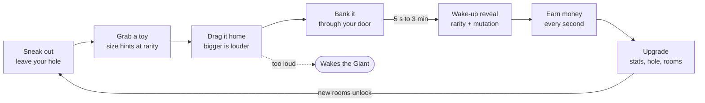

# Tiny Toy Heist: Day 1 Starting Plan

Snapshot of the game design doc on 18 Oct 2026, the day we locked in the concept.
The live, editable version is here: https://claude.ai/code/artifact/0ed341c5-17c5-4d87-af8c-479b7f472662

## Pitch

**You're ant-sized. The house is giant. Sneak out of your mouse hole, drag toys back past the sleeping giant, and watch them come alive.**

It's Steal An Egg's always-on loop with a new fantasy and one new mechanic: **physics carrying with noise**. Bigger, rarer toys are heavier and louder to drag, so every run is a greed-versus-risk bet.

Why this concept won over Grow a Kaiju, Catch a Nightmare and the UFO idea:

- **The fantasy already pulls players.** BE TINY AND ROB GRANDPA holds about 742 concurrent players with default-block art and no collection loop.
- **The proven money loop is untouched.** Steal, reveal a rarity, earn per second, get raided. Steal An Egg runs this loop at about 950K concurrent.
- **Nobody has combined them.** Rob Grandpa has the fantasy without the loop; the Steal games have the loop without this fantasy.
- **It's cheap to build.** At tiny scale, a table is a few big blocks and still reads as a whole level.
- **The thumbnail writes itself:** a tiny kid hauling a glowing toy past a giant sleeping face.

## Name

**Working title: Tiny Toy Heist.** A Roblox search for "toy heist" and "tiny thieves" returned no exact match. "Tiny Thieves" itself is too close to an existing game.

| Searched | Closest existing games (concurrent players, 18 Oct 2026) | Verdict |
| --- | --- | --- |
| tiny thieves | Tiny Thief: Steal Everything (16), BE TINY AND ROB GRANDPA (700), Rob Grandma! (172) | Taken, drop it |
| steal a toy | Steal A Toy (0), Steal A Toy! (0), Steal a Toy Box (35) | Taken, crowded with dead clones |
| toy heist | Bobo Heist (304), Egg Heist: Steal & Hatch (392), no "Toy Heist" | Open |

Backups if it collides later: *Mouse Hole Heist*, *Steal Toys From Giants*.

Toy Story 5 fan games are already on Roblox (Toy Story 5 Roleplay, 286 players), so "toys come alive" is a timely theme. All toys and characters must be original; no Disney or Pixar names or designs.

## Core loop

**Sneak out, grab a sleeping toy, drag it home without waking the Giant, watch it wake up, and spend what it earns on getting stronger.** Bigger toys pay more but are slower and louder, so every run is a greed bet.

The wake-up reveal is the hook: it decides rarity and mutation, the same job hatching does in Steal An Egg.

### Three loops at three speeds

| Loop | Length | What the player does | What keeps them going |
| --- | --- | --- | --- |
| Run | 30–120 s | Sneak, grab, carry, bank | Will I make it home? What will it be? |
| Session | 10–40 min | Upgrades, new rooms, raids, playtime gifts, daily quests | The next room, the next hole level |
| Long | Days to weeks | Toy Index, rebirths, events, Mythic hunting | Collection, status, limited event toys |

### A typical run, second by second

1. **0:00** Check the Giant's timer: 2:40 left in deep sleep.
2. **0:05** Pick a target. A Large toy in the Kitchen is worth more but sits on loud tile.
3. **0:20** Sneak across the Hallway rug; the cat is asleep on the couch.
4. **0:30** Grab. The Wake Meter ticks up as you drag it across the tile.
5. **0:45** Another player bumps a pan off the counter: +30 noise. The Giant goes to Stirring.
6. **0:50** Throw a Squeaky Decoy the other way, cut back onto the carpet, and drag through your door with 4 seconds to spare.
7. **0:55** The wake-up timer starts: 60 s for a Large toy.
8. **1:55** Reveal: an Epic Robot Dino, Gold mutation, $400 a second.
9. **2:00** Spend the cash pile on Strength 6, which opens the Kitchen for good.

### What makes it different from Steal An Egg

- **Carrying is a skill and a risk,** not a straight run: weight, floor type and bumps all matter.
- **The danger is shared.** One loud player wakes the Giant for everyone.
- **The reveal is earned.** You choose how greedy to be with size, and size sets the odds.

## The house and the threats

**One giant house per server, shared by up to 8 players, with no lobby.** You join and you're in your mouse hole within seconds.

**Rooms unlock as you get stronger.** Deeper rooms hold bigger toys.

1. Kid's Bedroom: the start, carpeted and quiet
2. Hallway
3. Kitchen: hard tile floor, loud
4. Living Room
5. Garage
6. Attic: late game

**The Giant Kid owns every toy.** He's asleep most of the time, and a timer on screen always shows when he wakes, like Steal An Egg's day/night cycle.

- **Asleep (about 4 minutes):** everyone loots. Noise fills a shared Wake Meter; fill it and he wakes early.
- **Awake (about 1 minute):** he gets up and walks toward the loudest noise. If he catches you, you drop your toy and get knocked back to your hole.
- **Hiding:** under the bed, behind furniture, or back in your hole.

**Noise is the core risk system,** and it's shared by the whole server:

- Dragging on tile is loud; dragging on carpet is quiet.
- Bumping a toy into furniture spikes the meter.
- Bigger toys are louder to drag.
- One greedy player can wake the Giant for everyone. That causes chaos, blame, and good clips.

**Extra threats, so one Giant doesn't have to cover 8 players:**

- **House cat:** prowls, pounces on tiny players and makes them drop what they carry.
- **Roomba:** follows a route and sucks up dropped toys, dumping them in its dock. The dock becomes a jackpot pile worth raiding.
- **Mousetraps:** guard the best spawns.

**Later event, Nightmare Night:** lights out, the Giant sleepwalks with a flashlight, and glow-in-the-dark toys spawn. It adds horror-lite tension and a reason to log in at set times.

### Rooms in detail

| Room | Unlocks at | Floor (noise) | Toy sizes that spawn | Hazards | Spawn points |
| --- | --- | --- | --- | --- | --- |
| Kid's Bedroom | Start | Carpet (x1) | Small, Medium | Giant Kid's bed sits here | 12 |
| Hallway | Strength 3 | Wood (x2) | Small, Medium | Cat's main route | 8 |
| Kitchen | Strength 6 + $10K | Tile (x3) | Medium, Large | Mousetraps under counters, Roomba dock | 14 |
| Living Room | Strength 10 + $250K | Rug + wood (x1 / x2) | Medium, Large | Cat naps on the couch, wakes on noise | 16 |
| Garage | Strength 14 + $5M | Concrete (x3) | Large, Giant | Dark corners, rolling tools | 10 |
| Attic | Rebirth 1 + Strength 18 | Old boards (x2), creaks | Large, Giant | Always dim; Nightmare Night spawns start here | 8 |

A room you haven't unlocked shows a glowing toy through a gap in the door, so players can always see the next goal.

### The Giant Kid's behaviour

| State | Lasts | What he does | What players do |
| --- | --- | --- | --- |
| Deep sleep | About 3 min | Snores; the Wake Meter drains 2 points a second | Loot freely; loud carries are fine |
| Light sleep | About 1 min | Rolls over, mumbles; drain slows to 1 a second | Finish carries, avoid tile |
| Stirring | 10 s warning | Sits up; a screen-wide "HE'S WAKING UP" banner | Hide or sprint home |
| Awake | 60 s | Walks to the loudest noise of the last 5 s; grabs anyone in reach | Hide under furniture or stay in your hole |
| Back to bed | 10 s | Walks back to bed | Toys respawn at empty spawn points |

If he grabs you, you drop your toy, get flung to your hole entrance with a 3-second stun, and lose nothing else. Being caught is funny, not punishing.

### Noise numbers

The Wake Meter runs from 0 to 100, is shared by the server, and is shown as a bar under the Giant's face icon. At 100 he skips straight to Stirring.

| Source | Wake Meter points |
| --- | --- |
| Walking | 0 |
| Sprinting on tile | 0.5 a second |
| Dragging Small / Medium / Large / Giant toy on carpet | 0.5 / 1 / 2 / 4 a second |
| Same, on wood or tile | x2 or x3 the carpet value |
| Bumping a toy into furniture | +8 (Small) to +25 (Giant) |
| Knocking an object off a shelf | +30 |
| Thrown Squeaky Decoy | +15, but the Giant walks to the decoy instead of you |

Every noise shows as a ripple ring on screen, coloured by loudness, so everyone can see who's being loud.

## Toys that come alive

**Toys lie around the house asleep. You can see a toy's size, but not what it is, until it wakes up in your hole.** Size hints at the odds; the wake-up is the reveal. This is the game's variable-ratio hook, the same job as hatching in Steal An Egg.

### How a toy goes from floor to shelf

1. **Spawn:** a sleeping toy appears at an empty spawn point under a grey blanket shape, with a size tag (Small, Medium, Large, Giant).
2. **Grab:** hold click (or hold the Grab button on mobile) for 0.5 s. Small toys go under your arm; bigger ones are dragged behind you.
3. **Carry home:** speed drops with size, and noise rises with size and floor type.
4. **Bank:** drag it through your mouse hole door. "+1 toy!" pops, and it goes on a free shelf slot.
5. **Wake-up:** a timer runs over the toy: Small 5 s, Medium 20 s, Large 60 s, Giant 3 min.
6. **Reveal:** the blanket shakes, the camera zooms in, the rarity colour bursts out, and the toy's name, rarity, mutation and money per second appear. Mythic and above flash a server-wide announcement.
7. **Earn:** the toy walks around your hole doing its idle animation and earns money every second.

### What a sleeping toy looks like

**By default, every sleeping toy is a grey blanket with a lump under it.** You can't tell a Rubber Duck from a Robot Dino, so every grab is a gamble. Three things let players peek:

- **Size tag:** a floating tag (Small, Medium, Large, Giant) with a "Zzz". The lump's size matches it, so the odds table below is all you know at a glance.
- **Glow tell:** Epic and above sometimes leak a faint glow from under the blanket in their rarity colour (purple, gold, red, rainbow). It flickers on for 1 second about every 8 seconds, so you only catch it if you're watching. Commons through Rares never glow.
- **Flashlight gadget:** shine it (hold the button) and every sleeping toy within 25 studs shows its **black silhouette** through the blanket for 5 seconds. You learn which toy it is, and so its rarity, but never its mutation, so the reveal still matters.

**Why it works this way:** silhouettes on every toy would give away rarity (each toy has a fixed rarity), so everyone would skip Commons and the gamble would die. Keeping them behind a gadget makes peeking a skill and a choice: the Flashlight beam is visible to other players and its click makes noise, so using it near the Giant is a risk.

| Peek method | What you learn | Cost | Risk |
| --- | --- | --- | --- |
| Size tag | Odds only | Free, always on | None |
| Glow tell | "It's Epic or better" | Free, needs patience | You wait in the open |
| Flashlight | Which toy it is (so its rarity), never its mutation | Gadget, 45 s recharge | The beam is visible and the click adds +3 noise |

### Odds by size

Shown in game as "1 in X" on every size tag, as Sol's RNG and Dig a Pet do.

| Rarity (colour) | Small | Medium | Large | Giant |
| --- | --- | --- | --- | --- |
| Common (grey) | 70% | 45% | 20% | 0% |
| Uncommon (green) | 24% | 35% | 35% | 20% |
| Rare (blue) | 5% | 15% | 28% | 35% |
| Epic (purple) | 0.9% | 4% | 13% | 30% |
| Legendary (gold) | 0.1% | 0.9% | 3.5% | 12% |
| Mythic (red) | 0% | 0.1% | 0.5% | 2.9% |
| Secret (rainbow) | 0% | 0% | 0% | 0.1% |

Luck boosts multiply the odds of Epic and above, then the rows are rescaled to 100%.

### Carrying by size

| Size | Walk speed while carrying | Noise per second on carpet | Strength needed | Co-carry |
| --- | --- | --- | --- | --- |
| Small | 95% | 0.5 | 0 | No |
| Medium | 80% | 1 | 0 | No |
| Large | 60% | 2 | 5 | Optional: 2 players move at 80% |
| Giant | 40% | 4 | 12 | Optional: 2 to 3 players move at 70% |

**Co-carry is a social hook.** Friends can drag a Giant toy together, but it belongs to whoever's hole it reaches first. Betrayal at the door makes great clips.

### Toy roster: 105 toys

Every toy, with its look, idle animation, money and perk, is in [Toy Catalog.md](Toy%20Catalog.md), which replaces the earlier 28-toy list. Each room has its own 14-toy set, and deeper rooms pay more for the same rarity. The MVP ships the 15 toys marked "(MVP)" there.

| Group | Toys | Money multiplier | Top toy |
| --- | --- | --- | --- |
| Kid's Bedroom set | 14 | x1 | Galaxy Unicorn Plush (Mythic, $15,000/s) |
| Hallway set | 14 | x1.5 | The Last Battery (Mythic, $25,000/s) |
| Kitchen set | 14 | x2.5 | Golden Spatula Sovereign (Mythic, $50,000/s) |
| Living Room set | 14 | x5 | Grandfather Clock Titan (Mythic, $120,000/s) |
| Garage set | 14 | x10 | Moon Rocket Rex (Mythic, $250,000/s) |
| Attic set | 14 | x25 | Chandelier Leviathan (Mythic, $600,000/s) |
| Halloween line | 7 | x5 | Headless Hobby Horse (Mythic, $150,000/s) |
| Nightmare Night line | 6 | x5 | The Night Watchman (Secret, $2,000,000/s) |
| Winter line | 5 | x5 | Aurora Reindeer (Mythic, $150,000/s) |
| Specials | 3 | fixed | The Original Teddy (Secret, $1,500,000/s) |

The catalog also has 14 shelf combos (toys that boost each other) and the rules for designing new toys.

### Mutations

Rolled once at wake-up, one mutation per toy. They multiply money per second and change the toy's look.

| Mutation | Chance | Money | Look |
| --- | --- | --- | --- |
| Gold | 5% | x2 | Gold sheen |
| Glitter | 2% | x3 | Sparkle particles |
| Glow | 10% during Nightmare Night only | x2.5 | Glow-in-the-dark |
| Shadow | 1% | x5 | Dark smoke outline |
| Rainbow | 0.2% | x10 | Cycling colours |
| Cosmic | 0.02% | x25 | Starfield texture, orbiting sparkles |
| Haunted (Halloween event) | 3% during the event | x4 | Ghostly trail; event-only, never returns |

### Toy Index

A book in your hole tracks every toy × mutation found: 84 room-set toys, 18 event toys, 3 specials and 7 mutations.

- **Each room's set completed:** +2% luck, a cash reward and a title ("Kitchen Raider").
- **Every base toy found:** an exclusive Index Teddy (Epic, gold mutation).
- **Server announcement** the first time anyone in the server finds a new Mythic.

## Mouse holes and raids

**Every player gets a mouse hole in the baseboards. All 8 line the same walls, so everyone can see who has the best toys, and anyone can sneak in and steal them.**

### Your hole

- **Door:** an arched hole in the baseboard with your name and best toy shown above it on a little sign.
- **Inside:** a cosy burrow with a shelf wall of toy slots, a cash pile that grows as toys earn, your Toy Index book, and a gadget bench.
- **Cash:** toys drop coins into the cash pile. Walk over it to collect, or own Auto-Collect (pass) or the Clockwork Dragon (perk).
- **Your hole leaves with you.** When you leave the server, your hole and toys vanish from that server and are saved. Raids only happen while you're online.

### Hole levels

Each level adds slots and changes the whole look, as in the pen-theme devlog clip. Your progress is visible from across the room.

| Level | Slots | Cost | Theme |
| --- | --- | --- | --- |
| 1 | 6 | Free | Cardboard and bottle caps |
| 2 | 8 | $500 | Sock-lined |
| 3 | 10 | $5,000 | Toy-brick walls |
| 4 | 12 | $50,000 | Cosy cabin |
| 5 | 15 | $500,000 | Candy land |
| 6 | 18 | $5,000,000 | Arcade neon |
| 7 | 20 | $50,000,000 + Rebirth 1 | Golden vault |

VIP Hole (pass) adds 3 slots on top at every level.

### Defences

| Defence | What it does | Cost |
| --- | --- | --- |
| Door Lock | Seals your door for 45 s; 2 min cooldown | Free; upgrades to 60 / 75 / 90 s for $20K / $400K / $8M |
| Mousetrap | Snaps the first raider through the door: 3 s stun, drops what they hold | $15K, rearms after 60 s |
| Alarm Bell | Rings and puts a red arrow on screen pointing at your hole the moment someone enters | $5K |
| Guard toys | Jack-in-the-Box and Snow Globe Spirit perks | Found, not bought |

### Raid rules, step by step

1. **Enter:** walk through another player's door while it's unlocked. Their Alarm Bell (if owned) rings.
2. **Grab:** hold on a shelf toy for 2 s. Awake toys squeak while dragged out, so the owner hears it.
3. **Escape:** drag it to your own hole. The carrying and noise rules are the same as in the house.
4. **Steal confirmed:** the toy is only yours once it crosses your door. Until then it's still the owner's.
5. **Stopped:** if the thief gets bonked by the owner (2 hits with the Pencil Bonk tool), caught by the Giant, pounced by the cat or trapped, they drop it.
6. **Dropped stolen toys** glow in the owner's colour. After 15 s untouched, they slide back home on their own. Before then, anyone can grab them.
7. **Notification:** "PlayerName stole your Robot Dino!" with a Revenge button that points an arrow at their hole for 30 s.

### Anti-grief rules

These keep raids fun for the person being raided.

- **New-player shield:** you can't be raided for your first 10 minutes or until you own 5 toys.
- **Small-hole protection:** players with fewer than 3 toys can't be raided.
- **No camping:** you can't raid the same player again for 90 s after a successful steal from them.
- **Lock is always free.** Defence is never paywalled; Robux only skips the cooldown.

## Progression

**Cash buys four stats that each change how a run feels. Rooms unlock on Strength, so a stronger thief literally reaches a bigger world.** Each level costs 1.6x the last, so early levels come every minute or two and later ones become session goals.

### Stats

| Stat | Per level | Max | Level 1 cost | What it unlocks |
| --- | --- | --- | --- | --- |
| Strength | +5% carry speed for Large and Giant toys | 20 | $100 | Large toys at 5, Giant toys at 12, and room gates (see Rooms) |
| Sneak | -3% noise from everything you do | 20 | $150 | At 10, footsteps make no noise even when sprinting |
| Speed | +4% walk and sprint speed | 20 | $120 | At 15, a quick dodge roll (2 s cooldown) |
| Grip | +5% chance to keep holding a toy when hit or pounced | 10 | $500 | At 10, a 50% chance not to drop |

### Gadgets

Gadgets are bought with cash and recharge over time. You carry 2 at once (3 with the Gadget Belt pass).

| Gadget | Effect | Cash cost | Recharge |
| --- | --- | --- | --- |
| Flashlight | Shows the silhouettes of sleeping toys within 25 studs for 5 s; the beam is visible and the click adds +3 noise | $800 (the first gadget most players buy) | 45 s |
| Squeaky Decoy | Throw it; the Giant and cat go to it instead of you | $2,000 | 90 s |
| Sock Slippers | Your noise -80% for 20 s | $1,000 | 60 s |
| Periscope | See the Giant, cat and Roomba through walls for 15 s | $3,000 | 60 s |
| Marble Bag | Scatter marbles; the cat or a raider slips and stuns for 2 s | $5,000 | 75 s |
| Pencil Bonk | Melee; 2 hits make a thief drop their toy | Free | 1 s |

Flashlight upgrades (cash): wider beam (25 → 40 studs), longer reveal (5 → 8 s), and at max level silhouettes show a faint rarity colour outline.

### Rebirth: "Growth Spurt"

Rebirth resets cash, stats and hole level. You keep every toy and your Toy Index.

| Rebirth | Requires | Reward |
| --- | --- | --- |
| 1 | $50M cash + Strength 18 | +50% money forever, Attic unlocked, hole level 7 available |
| 2 | $500M | +100% money total, a 3rd gadget slot |
| 3 | $5B | +200% money total, a rebirth-only toy (Mythic "Growth Chart Giraffe") |
| 4 to 10 | x10 each time | +100% money each, a cosmetic title each |

### Daily and session rewards

These are retention hooks copied from the games that hold players.

- **Playtime gifts in each session** at 5, 10, 20, 40 and 60 minutes. The 60-minute gift is a Large Mystery Toy.
- **7-day login streak:** day 1 $500 through day 7 a Giant Mystery Toy. Missing a day resets it.
- **3 daily quests,** for example "Bank 10 toys from the Kitchen", "Steal 2 toys" or "Carry a Giant toy with a friend". Each pays cash and a luck boost.
- **Free chest** by the hallway every 15 minutes.
- **Group join reward:** +10% money, and the group gets update pings.

## Monetization

**Lean on repeatable developer products, start with a nearly free first purchase, and sell speed, convenience, luck and looks.** In the Ghost Catchers clip, developer products earned about 6.5x more than game passes (160,826 vs 24,551 Robux). Steal An Egg opens with a 3-Robux x2 Speed.

### Game passes (one-time)

| Pass | Robux | What it does | Why people buy it |
| --- | --- | --- | --- |
| Starter Sneakers | 5 | x2 walk speed, permanent | First purchase almost free; buyers spend again far more easily |
| Auto-Collect | 99 | Cash flies to you from your hole wherever you are | Pure convenience |
| Gadget Belt | 79 | Carry 3 gadgets instead of 2 | Playstyle |
| Silent Socks | 149 | -25% noise from everything, permanent | Helps on every run |
| VIP Hole | 249 | +3 slots at every hole level, gold door, VIP chat tag | Status plus earning |
| 2x Money | 349 | Doubles all toy income forever | The classic best-seller |

### Developer products (repeatable)

| Product | Robux | What it does |
| --- | --- | --- |
| Mystery Toy x1 / x3 / x10 | 49 / 129 / 399 | A Large-size roll per toy; odds shown before buying |
| Instant Wake-Up | 15 / 25 / 35 / 59 | Skips the wake timer: Small / Medium / Large / Giant |
| Luck Boost, 15 min | 39 | x2 luck on Epic and above |
| Server Luck, 30 min | 199 | x2 luck for everyone in the server; the buyer's name is announced in gold |
| Lock Now | 19 | Skips the Door Lock cooldown once |
| Gadget Refill | 25 | Recharges all gadgets instantly |
| Cash packs | 29 to 999 | Scaled to the buyer's current progress, so they're never worthless |
| Event Crate (limited) | 99 / 299 for 1 / 3 | Event-only toys and mutations, with a countdown and odds shown |

### Rewarded video ads (free to the player)

- x2 money for 10 minutes
- One free Instant Wake-Up per hour
- Double a playtime gift
- A small free Mystery Toy every 30 minutes

### Premium Payouts

Roblox pays you for the time Premium members spend in the game. Toys earning in your hole, the AFK-friendly cash pile and the 60-minute gift all lengthen sessions. Premium players also get +10% money to make them want to stay.

### Lines we won't cross

Most players will be kids.

- **Odds are shown before every paid random item** (Roblox requires it). No fake "was 5,959" strikethrough prices.
- **Defence is never paywalled.** The Door Lock is free; Robux only skips its cooldown.
- **No selling relief from frustration we added on purpose.** For example, no paid "un-stun".
- **Stolen toys aren't lost forever to a whale.** The anti-grief rules apply to everyone.

## The first 60 seconds

**A new player steals, reveals and earns within 25 seconds, and is scared by the Giant before the first minute ends.** Steal An Egg gets its first pet earning in about 20 seconds; we match that. No step waits on reading.

| Time | What happens | What it teaches |
| --- | --- | --- |
| 0–3 s | Spawn inside your Level 1 hole. Banner: "You're tiny. Everything here is yours to steal." A big arrow points at your door. | Where home is |
| 3–8 s | Step out. A Small sleeping toy sits right outside, guaranteed. "Hold to GRAB" prompt. | Grabbing |
| 8–15 s | Drag it home. The Wake Meter bar flashes once with "Carpet = quiet, tile = LOUD". | Noise, in one line |
| 15–20 s | Bank it. A 5 s wake timer runs over the toy. | Banking |
| 20–25 s | Reveal. The first toy is always an Uncommon Plush Bunny: confetti, a camera zoom, "+$15/s". | The reward loop |
| 25–40 s | Scripted short stir: the Giant sits up for 8 s. "HIDE!" prompt with an arrow to the bed's shadow. | Fear and hiding |
| 40–50 s | Enough cash for Sneak level 1. The upgrade sign glows. Starter Sneakers offer for 5 Robux appears once, skippable. | Spending |
| 50–60 s | Camera pans past a glowing Legendary toy in the Kitchen behind a closed door ("Strength 6"), then past another player's hole: "You can steal from them too." | The long goal and raids |

### The first 10 minutes

- **Minutes 1–3:** five to eight Small and Medium toys banked; the first Rare comes from scripted good luck; Strength 3 reached, so the Hallway opens.
- **Minutes 3–5:** first natural wake-up. The player hides or gets caught (which is funny and costs nothing). The first free chest pops.
- **Minutes 5–10:** the playtime gift at 5 min, the first daily quest done, hole Level 2 bought (new sock-lined look), and the new-player shield ends at 10 min with a heads-up: "Lock your door when you leave it!"

### Reasons to come back tomorrow

The 7-day streak, half-finished room sets in the Index, Toy Index luck bonuses, the Kitchen door still locked, and a Giant toy you couldn't carry yet.

## MVP: a 3-week build

**Ship the smallest version that proves the loop: steal, carry with noise, wake-up reveal, earn, get raided.** Bedroom, Hallway and Kitchen only; the cat, Roomba, Garage, Attic, rebirth and Nightmare Night come in updates.

### In the MVP

- One floor: Bedroom, Hallway, Kitchen, with 8 hole slots along the walls
- The Giant Kid's full sleep/wake cycle, the Wake Meter and the chase-and-grab
- Physics drag for Small, Medium and Large toys (Giant toys and co-carry come in update 1)
- 15 toys across Common to Legendary, plus the Gold and Rainbow mutations
- The wake-up timer and reveal animation
- Money per second, cash pile, hole Levels 1–4
- Strength, Sneak and Speed stats, plus the Flashlight gadget and the glow tell
- Raids with Door Lock, the Pencil Bonk and the anti-grief rules
- Saving progress
- Starter Sneakers, Auto-Collect and 2x Money passes; Mystery Toy, Instant Wake-Up and Luck Boost products; one rewarded ad
- The first-60-seconds tutorial

### Build plan

**Week 1: the feel**

- [ ] Grey-box the house at tiny scale: Bedroom, Hallway, Kitchen, baseboard holes
- [ ] Grab-and-drag: server-owned toy, client input, speed penalty by size
- [ ] Noise: compute from drag speed, toy size and floor material on the server; Wake Meter UI
- [ ] Giant Kid: state machine (deep sleep, light sleep, stirring, awake, back to bed), walk to the loudest noise, grab and fling
- [ ] Playtest with 2–3 friends. If dragging past the Giant isn't fun by Friday, fix it before building anything else.

**Week 2: the loop**

- [ ] Toy spawner with size tags and the odds table
- [ ] Hole shelf slots, wake-up timer, reveal animation (zoom, burst, sound)
- [ ] Money per second, cash pile, collect
- [ ] Stats and hole-level upgrades with their visual themes
- [ ] Saving data, with session locking so toys can't be duplicated
- [ ] Raids: enter, grab, drop, steal confirmed at the door, Door Lock, Pencil Bonk, anti-grief rules

**Week 3: polish and money**

- [ ] 15 voxel toy models with idle animations
- [ ] Tutorial, playtime gifts, free chest, daily quests
- [ ] Passes, developer products and the rewarded ad, with odds shown on Mystery Toy
- [ ] Mobile controls: tap to grab, hold to drag, big buttons; test on a real phone
- [ ] Sounds: snoring, footsteps per floor, squeaky toys, the reveal sting
- [ ] Thumbnail, icon, description; soft launch to friends and the group

### Technical approach

- **Server decides everything that matters.** Toy ownership, money, odds, noise and steals are all calculated on the server. The client only sends "I'm grabbing" and "I'm moving", so exploiters can't spawn toys or money.
- **Dragging:** the toy is attached to the player with a physics constraint the server controls, so others see it smoothly and it bumps into furniture for real (which is what makes noise).
- **Saving:** use a proven save library with session locking, so a player in two servers can't duplicate toys. Save toys, cash, stats, hole level, Index and streak.
- **Code setup:** Roblox Studio plus Luau, kept in files on your computer (with a tool like Rojo) so I can help write and fix scripts in this project folder.
- **Performance:** 8 players, at most 40 loose toys in the house at once, and simple voxel models so phones keep up.

## Launch plan

**Start building an audience on day 1 of development, test the thumbnail before launch, then put about 10K Robux into Roblox ads in launch week and let the numbers decide.** Every dev in the clips you shared got players from TikTok first; the games with no push sit at 0–50 players.

### Thumbnail concepts (test all three)

1. **The haul:** a tiny Roblox kid dragging a glowing gold Robot Dino three times their size across a carpet. A giant sleeping face fills the background, one eye cracking open. Text: "DON'T WAKE HIM".
2. **The raid:** a split shot. On the left, "YOU!" with an arrow at a kid sneaking out of someone's mouse hole with a Rainbow toy; on the right, the owner running in. Text: "STEAL THEIR TOYS".
3. **The reveal:** a toy bursting out of its blanket with a Mythic red glow and "$30,000/s" in huge numbers.

Rules from the winners: one character facing the camera, one big glowing item, one huge number or short phrase, and colours that pop against Roblox's white page.

### TikTok devlog plan

Post 3–5 times a week from the first day of building. Format: 15–30 s, the hook in the first 2 seconds, gameplay on screen.

- Day 1: "I'm making a Roblox game where you're tiny and steal toys from a giant"
- First Giant chase clip: "He heard me drag the toy across the tile"
- The reveal animation: "POV: you pulled a Mythic"
- Co-carry betrayal: "My friend helped me carry it… then took it to HIS hole"
- Poll: "Which toy should be the next Mythic?" (comments pick it)
- The 3 thumbnails: "Which one would you click?" (free thumbnail test)
- Launch day: "My game is out. First 100 players get a free Gold Rubber Duck" (code in the description)

### Launch week

1. **Day 0:** publish, post the launch TikTok, announce in the group, start ads.
2. **Days 0–4:** spend about 10K Robux on Roblox ads, split across two audiences (all players vs engaged players), as in the +1 Drill Speed clip.
3. **Day 3:** first patch from feedback (bugs, balance).
4. **Day 7:** first content update (2 new toys + a mutation) with "UPDATE" in the title.
5. **Then weekly updates,** with the next update's countdown shown on the sign above every hole, as Steal An Egg does.

### Numbers to watch, and what they decide

These are our own go/no-go bars to start with, not official Roblox benchmarks. Adjust them after the first week of real data.

| Metric | Keep going if | Fix this first if it's low |
| --- | --- | --- |
| Thumbnail click rate (ads) | Clearly beats our other thumbnails | Thumbnail and title |
| Players who come back the next day | 1 in 5 or better | First 60 seconds, first 10 minutes |
| Average session length | 15 minutes or more | Mid-game goals, raids, gifts |
| Players who buy anything | Starter Sneakers bought by a visible share of players | Offer timing, price, value |
| Concurrent players after ads stop | Stays above zero and grows with each update | Whole loop; consider a reskin |

## Update roadmap: the first 8 weeks after launch

**One update every week, each adding something you can see in a thumbnail.** Every update gets "[UPDATE]" in the title, a TikTok, and a countdown on the sign above every hole the week before.

1. **Week 1, Giant Toys and Co-Carry:** Giant-size toys, 2–3 player co-carry, 3 new toys, Shadow mutation.
2. **Week 2, The Cat:** the house cat with its patrol and pounce, Marble Bag gadget, cat-themed toys (Yarn Ball Kitten, Rare).
3. **Week 3, Living Room:** a new room, 4 toys, hole Level 5 (Candy land), Glitter mutation.
4. **Week 4, Nightmare Night:** a timed night event every 30 minutes, the Glow mutation, the Lava Lamp Blob, a spooky Giant sleepwalk.
5. **Week 5, The Roomba and Garage:** Roomba plus dock jackpot, the Garage, Giant-size spawns, hole Level 6 (Arcade neon).
6. **Week 6, Rebirth:** Growth Spurt rebirths 1–3, the Attic, the Growth Chart Giraffe.
7. **Week 7, Trading:** safe two-player trade window with both players confirming twice and a value check.
8. **Week 8, Seasonal event:** a limited event toy line and crate, a 14-day countdown, an exclusive mutation that never returns.

If a week's numbers show a problem (for example people quitting after being raided), that week's update fixes it instead.

## Art, sound and effects

**Cheap voxel art, but generous effects.** The pet games you shared use blocky voxel models; what sells them is the glow, the shake and the big numbers.

- **Toys:** voxel models about 40–120 blocks each, bright solid colours, one idle animation each (bounce, spin, waddle). Mythics get particle auras.
- **House:** smooth giant furniture at real scale, warm night lighting with moonlight through the window, darker toward the Garage and Attic.
- **The Giant Kid:** large, soft and cartoony, never gory. Snoring makes his chest rise. Waking is a slow eye-open close-up.
- **Reveal:** blanket shake, a drum roll that rises with rarity, a camera zoom, a colour burst, the rarity name in huge letters, and "$X/s" counting up. Mythic and above: brief slow motion and a server-wide banner.
- **Noise feedback:** ripple rings on the floor coloured by loudness, a Wake Meter that shakes near full, and the Giant's snore cutting out at 80%.
- **Sound list:** snoring loop, footsteps per floor (carpet, wood, tile, concrete), drag scrapes per floor, toy squeaks, a cat purr and hiss, the Roomba hum, the door lock click, an alarm bell, and reveal stings per rarity.
- **UI:** chunky rounded buttons in the style players already know from Steal An Egg and Dig a Pet: Shop, Index and Upgrades on the left; money and the Giant timer always visible.

## Risks

**The biggest risk is that dragging toys feels clunky. Test it in week 1 before anything else gets built.** Each risk below has the cheapest check that settles it.

| Risk | Why it could kill the game | Cheapest check | Fallback |
| --- | --- | --- | --- |
| Physics dragging feels janky or lags with 8 players | It's the core mechanic and the clip | 2-day prototype; test with 3 friends on PC and a phone | Snap toys to a carry point; keep weight as a speed penalty only |
| One Giant can't threaten 8 players at once | Free looting gets boring fast | Count how often players feel in danger in a 10-minute playtest | Bring the cat into the MVP; shorten the deep-sleep phase |
| Raids feel unfair and make kids quit | Losing a Mythic to a stranger hurts | Watch reactions in playtests; track quits right after being raided | Longer free locks, steal-back window, partial cash payout to the victim |
| The theme doesn't pull clicks | No clicks means no players | TikTok "which would you click?" thumbnail post before week 3 | Same loop, reskin to a theme that tested better |
| Mobile controls are awkward | Most Roblox players are on phones | Play the whole first 10 minutes on a phone in week 3 | Auto-grab when close; a big single drag button |
| A bigger studio copies it fast | Clones follow any hit in days | Can't prevent it | Weekly updates, an active group, and being first on TikTok |
| Economy breaks (too fast or too slow) | Players finish or quit early | Time how long a tester takes to reach Kitchen (aim for about 10 minutes) | Tune the 1.6x cost curve and toy income |
| Exploiters duplicate toys or money | Ruins trades and fairness | Saves with session locking; all logic on the server | Ban waves; roll back dupes |
